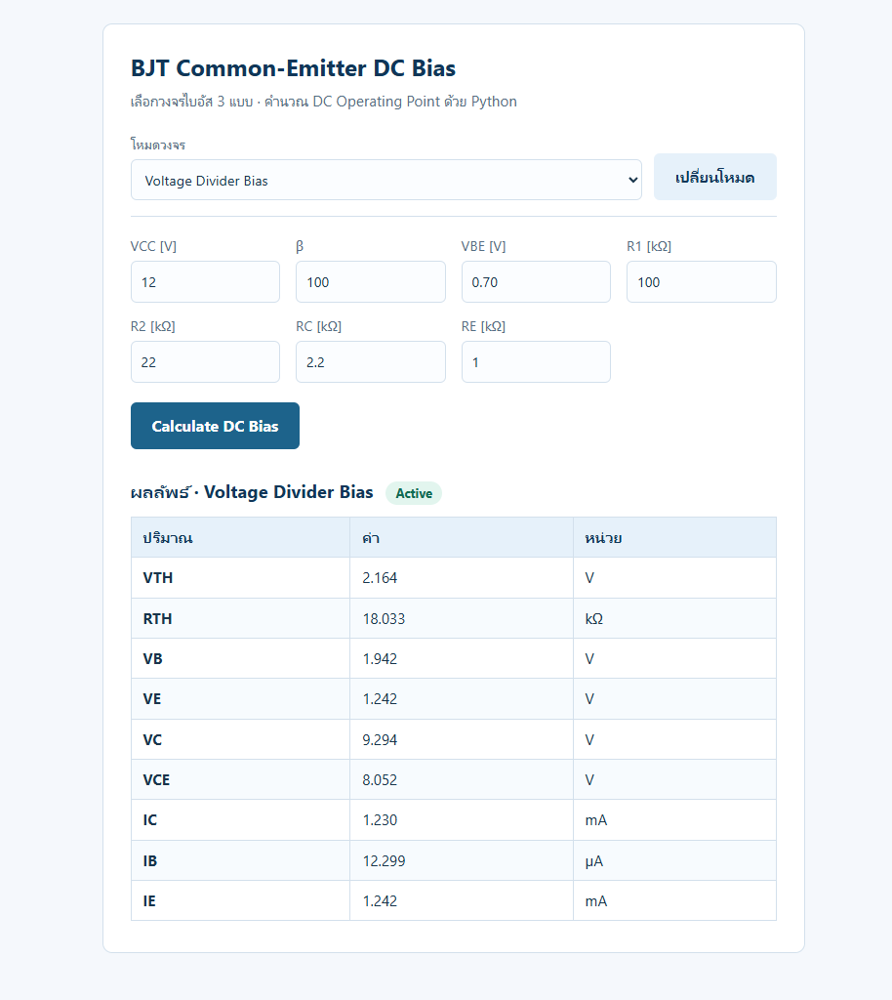

# Validation — BJT DC Bias Web App

## 1. เคสอ้างอิง

อินพุต: VCC = 12 V, R1 = 100 kΩ, R2 = 22 kΩ, RC = 2.2 kΩ, RE = 1 kΩ, β = 100, VBE = 0.70 V

การคำนวณมือ (ใช้สมการเดียวกับ `dc_bias.py` แต่คำนวณแยกด้วยเครื่องคิดเลข):

```
VTH = 12 × 22 / 122          = 2.1639 V
RTH = 100 × 22 / 122         = 18.033 kΩ
IB  = (2.1639 − 0.70) / (18033 + 101×1000) = 1.2299e-5 A
IC  = 100 × IB               = 1.2299 mA
IE  = 101 × IB               = 1.2422 mA
VE  = IE × 1000              = 1.2422 V
VB  = VE + 0.70              = 1.9422 V
VC  = 12 − IC × 2200         = 9.2942 V
VCE = VC − VE                = 8.0520 V
```

| ปริมาณ | คำนวณมือ | ค่าที่แสดงบนเว็บ (ทศนิยม 3 ตำแหน่ง) | ผลต่าง |
|---|---|---|---|
| VTH | 2.1639 V | 2.164 V | 0.0001 V (ปัดเศษ) |
| RTH | 18.033 kΩ | 18.033 kΩ | 0 |
| IB | 12.299 µA | 12.299 µA | 0 |
| IC | 1.2299 mA | 1.230 mA | 0.0001 mA (ปัดเศษ) |
| IE | 1.2422 mA | 1.242 mA | 0.0002 mA (ปัดเศษ) |
| VE | 1.2422 V | 1.242 V | 0.0002 V (ปัดเศษ) |
| VB | 1.9422 V | 1.942 V | 0.0002 V (ปัดเศษ) |
| VC | 9.2942 V | 9.294 V | 0.0002 V (ปัดเศษ) |
| VCE | 8.0520 V | 8.052 V | 0 |
| Region | Active | Active | ตรงกัน |

สรุป: ผลจากเว็บตรงกับการคำนวณมือ โดยผลต่างที่เหลือทั้งหมดมาจากการปัดเศษ
เพื่อแสดงผล 3 ตำแหน่ง (น้อยกว่า 0.01 %)

## 2. ผลการรันเทสต์

```
python -m unittest discover -s tests -v

Ran 38 tests in 0.05s

OK
```

| ไฟล์ | จำนวน | สิ่งที่ตรวจ |
|---|---|---|
| `tests/test_dc_bias.py` | 22 | ค่าสมการอ้างอิง, region, kΩ→Ω, whitespace, comma decimal, validation, β = 1e6, nan/inf, Fixed/Emitter, `as_dict()`, เกณฑ์ 0.2 V, parse ตามโหมด |
| `tests/test_web.py` | 16 | GET ฟอร์ม, POST แสดงผล, ฟิลด์หาย, ค่าผิด, POST ว่าง, เลือกโหมด, โหมดไม่รู้จัก, ผลรอบก่อนไม่ค้าง, error ระบุโหมด, template อ่านคีย์ dict |

## 3. เคสนอกช่วง Forward-Active (ต้องมี warning)

### Cutoff — VBE = 3.0 V (สูงกว่า VTH)

| ปริมาณ | ค่าที่ได้ | หมายเหตุ |
|---|---|---|
| IB | −7.024 µA | ติดลบ → สมมติฐาน forward-active ผิด |
| IC | −0.702 mA | ติดลบเช่นกัน |
| Region | `CUTOFF` | แสดง badge Cutoff |

หน้าเว็บแสดงแบนเนอร์เตือน "แบบจำลอง forward-active ใช้ไม่ได้กับค่านี้ — ตัวเลขด้านล่าง
เป็นค่าดิบจากสมการ ไม่ใช่คำตอบที่เชื่อถือได้" และขีดฆ่าค่าทุกตัว

### Saturation — RC = 10 kΩ

| ปริมาณ | ค่าที่ได้ | หมายเหตุ |
|---|---|---|
| IC | 1.230 mA | ค่าจากสมการ forward-active |
| VCE | −1.541 V | ต่ำกว่า VCE(sat) 0.2 V มาก และติดลบ |
| Region | `SATURATION` | แสดง badge Saturation + warning |

**ข้อจำกัด:** ตัวเลขในสองเคสข้างต้น **ไม่ใช่** ผลจำลองที่แม่นยำ เป็นเพียงค่าที่สมการ
forward-active ให้เมื่อเงื่อนไขไม่เป็นจริง การหาคำตอบจริงในย่านนี้ต้องใช้แบบจำลอง
อิ่มตัว (หรือ SPICE) ซึ่งอยู่นอกขอบเขตของ Lab นี้

## 4. การตรวจสอบด้วยเบราว์เซอร์จริง (Lab 02)

| การกระทำ | ผลที่เห็น |
|---|---|
| เปิด <http://127.0.0.1:5000/> | HTTP 200, เห็นฟอร์ม 7 ช่อง พร้อมค่าเริ่มต้น |
| กด Calculate ด้วยค่าเริ่มต้น | VCE 8.052 V, IC 1.230 mA, badge **Active** |
| ใส่ β = 0 | ข้อความ "β ต้องมากกว่า 0" และฟอร์มยังใช้งานได้ (HTTP 200) |
| ใส่ VBE = 3 (VTH = 2.164) | badge **Cutoff**, ค่าถูกขีดฆ่า, มี warning |

## 5. Lab 03 — ตาราง A1–A5 (ตรวจผ่าน Playwright MCP)

ค่าคงที่ที่ใช้ร่วมกัน: VCC = 12 V, RC = 2.2 kΩ, β = 100, VBE = 0.70 V
เกณฑ์: IC คลาดไม่เกิน 0.01 mA, VCE คลาดไม่เกิน 0.02 V เทียบกับค่าอ้างอิงที่ยังไม่ปัดเศษ

ค่าอ้างอิงคำนวณแยกจากตัวโปรแกรม (สมการในใบงาน + เครื่องคิดเลข):

```
A1 Divider R1=100k R2=22k RE=1k
   VTH=2.1639  RTH=18032.8  IB=(2.1639-0.70)/(18032.8+101×1000)=12.299 µA
   IC=1.2299 mA  VCE=8.0522 V
A2 Fixed RB=1M
   IB=(12-0.70)/1e6=11.300 µA  IC=1.1300 mA  VCE=12-1.13×2.2=9.5140 V
A3 Emitter RB=1M RE=1k
   IB=(12-0.70)/(1e6+101×1000)=10.263 µA  IC=1.0263 mA  VCE=8.7054 V
A4 Emitter RB=1M RE=2k
   IB=(12-0.70)/(1e6+101×2000)=9.401 µA  IC=0.9401 mA  VCE=8.0328 V
```

| ID | โหมด + อินพุต | คาดหมายก่อนรัน | เห็นจริง | วิธีตรวจ | สถานะ |
|---|---|---|---|---|---|
| A1 | Divider · R1=100k, R2=22k, RE=1k | IC 1.2299 mA · VCE 8.0522 V | IC 1.230 mA · VCE 8.052 V · badge Active | Playwright MCP | PASS |
| A2 | Fixed · RB=1000 kΩ | IC 1.1300 mA · VCE 9.5140 V | IC 1.130 mA · VCE 9.514 V · VE 0.000 V · ไม่มีแถว VTH | Playwright MCP | PASS |
| A3 | Emitter · RB=1000 kΩ, RE=1k | IC 1.0263 mA · VCE 8.7054 V | IC 1.026 mA · VCE 8.705 V · VB 1.737 V | Playwright MCP | PASS |
| A4 | Emitter · เหมือน A3 แต่ RE=2k | ทำนาย: RE ↑ → IB ↓ → **IC ลด** · IC 0.9401 mA · VCE 8.0328 V | IC 0.940 mA · VCE 8.033 V · VE 1.899 V | Playwright MCP | PASS |
| A5 | Fixed · RB=0 | ข้อความให้แก้ RB, เว็บไม่ล่ม, ไม่แสดงผลรอบก่อน | "RB [kΩ] ต้องมากกว่า 0 kΩ" · ไม่มีส่วนผลลัพธ์ · HTTP 200 | Playwright MCP | PASS |

### หลักฐานที่คัดจากหน้าเว็บ (Snapshot)

A1 — โหมด Voltage Divider Bias หลังกด **Calculate DC Bias**:

```
ผลลัพธ์ · Voltage Divider Bias   [Active]
VTH  2.164 V     RTH  18.033 kΩ
VB   1.942 V     VE   1.242 V     VC   9.294 V
VCE  8.052 V     IC   1.230 mA    IB  12.299 µA   IE  1.242 mA
```

A5 — โหมด Fixed Bias, RB = 0:

```
ไม่สามารถคำนวณได้ · Fixed Bias
  • RB [kΩ] ต้องมากกว่า 0 kΩ
```

> หลัง error ไม่มีส่วน "ผลลัพธ์" หลงเหลืออยู่บนหน้า — ตรงตามที่ใบงานกำหนด

### ภาพหลักฐานจาก Chrome (Playwright MCP)

| กรณี | ภาพ |
|---|---|
| A1 Divider (ผลเดิมไม่เสีย) | [`evidence/lab03-a1-divider.png`](evidence/lab03-a1-divider.png) |
| A4 Emitter RE = 2 kΩ | [`evidence/lab03-a4-emitter-re2.png`](evidence/lab03-a4-emitter-re2.png) |
| A5 Fixed RB = 0 (error) | [`evidence/lab03-a5-fixed-rb0.png`](evidence/lab03-a5-fixed-rb0.png) |




> **วิธีตรวจ:** **Playwright MCP 1.66.0** ควบคุม Chrome จริงผ่าน `npx -y @playwright/mcp@latest
> --browser chrome --isolated` — เปิดหน้า อ่าน Snapshot กรอกฟอร์ม กดปุ่ม และอ่านผลจาก DOM
> ไม่ได้อ่านโค้ดหรือใช้ curl แทน
> หมายเหตุ: background service ของ OpenCode บนเครื่องนี้ถือ PATH ก่อนติดตั้ง Node.js
> จึงต้องชี้ `environment.PATH` ไปที่โฟลเดอร์ Node ระหว่างรอบตรวจ (แก้ได้ถาวรด้วย
> `opencode service restart`)

## 6. การทวนซ้ำกรณี A4 (รอบที่ 2 แยกจาก A1–A5)

วิธี: เปิด <http://127.0.0.1:5000/?mode=emitter> กรอก VCC=12, RB=1000, RC=2.2, β=100, VBE=0.70
กรอก RE=1 แล้วกดคำนวณ จากนั้นเปลี่ยน **เฉพาะช่อง RE** เป็น 2 แล้วกดคำนวณใหม่ (ไม่แตะช่องอื่น)

| วันที่ | กรณี | สิ่งที่เปลี่ยน | IC ที่เห็น | VCE ที่เห็น | ตรงกับรอบ A1–A5 |
|---|---|---|---|---|---|
| 2026-11-17 | A4 | RE 1k → 2k | 1.026 → 0.940 mA | 8.705 → 8.033 V | ตรง และลดลงตามที่ทำนาย |

หลักฐาน: หลังส่งฟอร์มครั้งที่สอง ช่อง `mode` ยังเป็น `emitter`, ช่อง `re` เป็น `2`
และหัวผลยังเป็น "ผลลัพธ์ · Emitter Bias" — ยืนยันว่าเปลี่ยนช่องถูกและเกิดการส่งฟอร์มจริง
ผลตรงกับค่าอ้างอิงที่คำนวณมือ (0.9401 mA / 8.0328 V) ภายในเกณฑ์ 0.01 mA / 0.02 V

## 7. สิ่งที่ยังไม่ได้ตรวจสอบ

- ไม่ได้ทดสอบกับค่าจาก datasheet ของ BJT รุ่นจริง (เช่น 2N2222, BC547)
- ไม่ได้ทดสอบอุณหภูมิหรือการเปลี่ยนแปลงของ β ตามกระแส
- ไม่ได้ทดสอบพร้อมกันหลายผู้ใช้ (development server ไม่ได้ออกแบบมาสำหรับงานนั้น)


## 8. Lab 04 — CE Amplifier Simulator (ngspice) B1–B8

วิธีตรวจ: รัน Flask app ที่ `http://127.0.0.1:5000/` แล้วใช้ Playwright MCP/browser automation ควบคุมหน้าเว็บจริง กดรัน simulation และอ่านค่าจาก DOM/screenshot; B7 ตรวจเพิ่มด้วย automated test และ direct engine check (จำลอง ngspice ไม่พบ) เพราะเซิร์ฟเวอร์ที่รันอยู่ยังค้นหา ngspice จริงใน PATH ได้

| Case | ขั้นตอน | ค่าที่สังเกต (จริง) | ผล | หลักฐาน |
|---|---|---|---|---|
| B1 | เปิดหน้าแรก | มีส่วน Lab 03 เดิม และส่วน `CE Amplifier Simulator (ngspice)` พร้อม input/freq/amp/Run Simulation/canvas | PASS | `docs/evidence/lab04-b2-op.png` |
| B2 | เลือก `.op` กด Run Simulation | `VB=2.0507 V, VE=1.3795 V, VC=8.9790 V, VCE=7.5995 V, IC=1.4727 mA`, สถานะสำเร็จ Engine ngspice, Model Q2N3904_LAB04, Run ec29215cf704 | PASS | `docs/evidence/lab04-b2-op.png` |
| B3 | เลือก `.ac` กด Run Simulation | สถานะ `สำเร็จ (ac)` Run 64c28b20c164, แสดง Bode chart (gain/phase) จาก ngspice จริง | PASS | `docs/evidence/lab04-b3-ac-chart.png` |
| B4 | เลือก `.tran` กด Run Simulation | สถานะ `สำเร็จ (tran)` Run d064b6f47782, แสดงกราฟ Vin/Vout จาก ngspice จริง | PASS | `docs/evidence/lab04-b4-tran.png` |
| B5 | เปลี่ยน `freq=5000 Hz`, `amp=20 mVpk` แล้วรัน `.tran` ใหม่ | สถานะ `สำเร็จ (tran)` Run 63b2965e276a (run id เปลี่ยน) กราฟอัปเดตจากการรันใหม่ | PASS | `docs/evidence/lab04-b5-tran-freq5k.png` |
| B6 | ตั้ง `RE=0` แล้วรัน | สถานะ `Simulation ล้มเหลว`, error `RE ต้องมีค่ามากกว่า 0`, ตาราง/กราฟ SPICE ถูกซ่อน (ไม่มี stale success) | PASS | `docs/evidence/lab04-b6-invalid.png` |
| B7 | จำลอง ngspice ไม่พบ (`NGSPICE_EXE` ผิด + ไม่มีใน PATH/common paths) | ได้ `NgspiceNotFoundError` พร้อมข้อความแนะนำตั้ง `NGSPICE_EXE` และรายการ path ที่ตรวจ; API path คืน `ok:false` (ยืนยันโดย `tests.test_web.TestSpiceApi.test_missing_ngspice_reports_error`) | PASS | direct engine check + automated test |
| B8 | คำนวณ Lab 03 Divider ค่าอ้างอิงเดิม | ผล `VTH=2.164 V, RTH=18.033 kΩ, VB=1.942 V, VE=1.242 V, VC=9.294 V, VCE=8.052 V, IC=1.230 mA, Active` | PASS | `docs/evidence/lab04-b8-regression.png` |

### หมายเหตุ Lab 04

- ผล SPICE เป็นค่าจาก ngspice จริงของโมเดล `Q2N3904_LAB04` ที่ประกาศชัดเจนใน `spice_engine.py`; ไม่ใช่ค่าจาก datasheet จริงของอุปกรณ์เฉพาะรุ่น
- B7 ไม่ได้ทำโดยการลบ ngspice ออกจากเครื่อง แต่ตรวจด้วย mock/direct check และ unit test เพื่อหลีกเลี่ยงการกระทบสภาพแวดล้อม
- ไม่ได้ทดสอบ AC ครบทุก bias mode ตามขอบเขต v1 (จำกัด CE Voltage Divider reference circuit)
