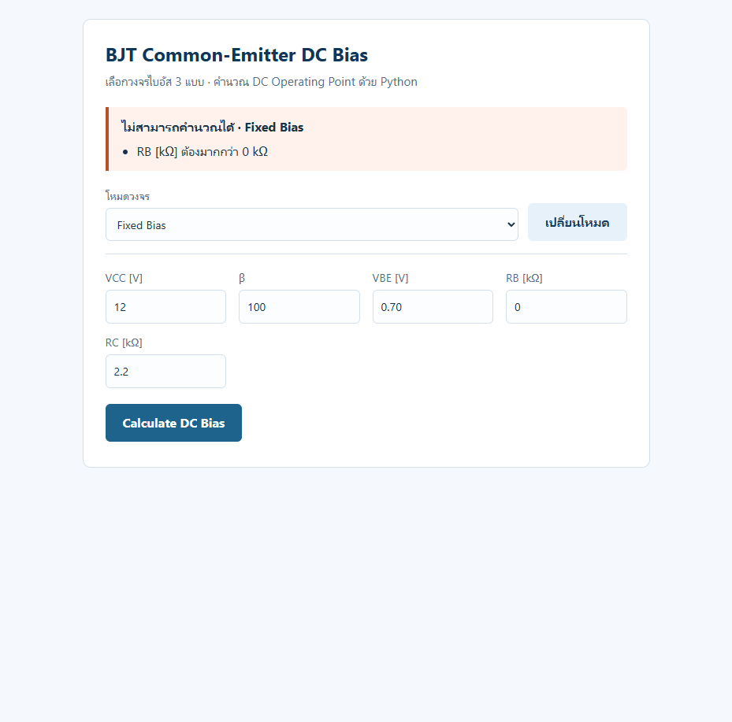

# Validation — BJT DC Bias Web App

## 1. เคสอ้างอิง

อินพุต: VCC = 12 V, R1 = 100 kΩ, R2 = 22 kΩ, RC = 2.2 kΩ, RE = 1 kΩ, β = 100, VBE = 0.70 V

การคำนวณมือ (ใช้สมการเดียวกับ `dc_bias.py` แต่คำนวณแยกด้วยเครื่องคิดเลข):

```
VTH = 12 × 22 / 122          = 2.1639 V
RTH = 100 × 22 / 122         = 18.033 kΩ
IB  = (2.1639 − 0.70) / (18033 + 101×1000) = 1.2299e-5 A
IC  = 100 × IB               = 1.2299 mA
IE  = 101 × IB               = 1.2422 mA
VE  = IE × 1000              = 1.2422 V
VB  = VE + 0.70              = 1.9422 V
VC  = 12 − IC × 2200         = 9.2942 V
VCE = VC − VE                = 8.0520 V
```

| ปริมาณ | คำนวณมือ | ค่าที่แสดงบนเว็บ (ทศนิยม 3 ตำแหน่ง) | ผลต่าง |
|---|---|---|---|
| VTH | 2.1639 V | 2.164 V | 0.0001 V (ปัดเศษ) |
| RTH | 18.033 kΩ | 18.033 kΩ | 0 |
| IB | 12.299 µA | 12.299 µA | 0 |
| IC | 1.2299 mA | 1.230 mA | 0.0001 mA (ปัดเศษ) |
| IE | 1.2422 mA | 1.242 mA | 0.0002 mA (ปัดเศษ) |
| VE | 1.2422 V | 1.242 V | 0.0002 V (ปัดเศษ) |
| VB | 1.9422 V | 1.942 V | 0.0002 V (ปัดเศษ) |
| VC | 9.2942 V | 9.294 V | 0.0002 V (ปัดเศษ) |
| VCE | 8.0520 V | 8.052 V | 0 |
| Region | Active | Active | ตรงกัน |

สรุป: ผลจากเว็บตรงกับการคำนวณมือ โดยผลต่างที่เหลือทั้งหมดมาจากการปัดเศษ
เพื่อแสดงผล 3 ตำแหน่ง (น้อยกว่า 0.01 %)

## 2. ผลการรันเทสต์

```
python -m unittest discover -s tests -v

Ran 57 tests in 0.41s

OK
```

| ไฟล์ | จำนวน | สิ่งที่ตรวจ |
|---|---|---|
| `tests/test_dc_bias.py` | 22 | ค่าสมการอ้างอิง, region, kΩ→Ω, whitespace, comma decimal, validation, β = 1e6, nan/inf, Fixed/Emitter, `as_dict()`, เกณฑ์ 0.2 V, parse ตามโหมด |
| `tests/test_spice_engine.py` | 7 | model constant, ngspice discovery, netlist, `.op` parse, `.ac` parse (รวม phase เป็นองศา), `.tran` parse, run id |
| `tests/test_web.py` | 28 | GET/POST ฟอร์ม Lab 03, validation, โหมด, `/api/simulate`, UI simulator, Chart.js, เอกสาร, และ regression ของ Impeccable fixes (aria-live, tick format, thead, mobile mode bar, time label) |

> 38 เทสต์แรกเป็นของ Lab 03; Lab 04 เพิ่ม 19 เทสต์ (engine 7 + web/UI/API 12) รวมเป็น 57 เทสต์

## 3. เคสนอกช่วง Forward-Active (ต้องมี warning)

### Cutoff — VBE = 3.0 V (สูงกว่า VTH)

| ปริมาณ | ค่าที่ได้ | หมายเหตุ |
|---|---|---|
| IB | −7.024 µA | ติดลบ → สมมติฐาน forward-active ผิด |
| IC | −0.702 mA | ติดลบเช่นกัน |
| Region | `CUTOFF` | แสดง badge Cutoff |

หน้าเว็บแสดงแบนเนอร์เตือน "แบบจำลอง forward-active ใช้ไม่ได้กับค่านี้ — ตัวเลขด้านล่าง
เป็นค่าดิบจากสมการ ไม่ใช่คำตอบที่เชื่อถือได้" และขีดฆ่าค่าทุกตัว

### Saturation — RC = 10 kΩ

| ปริมาณ | ค่าที่ได้ | หมายเหตุ |
|---|---|---|
| IC | 1.230 mA | ค่าจากสมการ forward-active |
| VCE | −1.541 V | ต่ำกว่า VCE(sat) 0.2 V มาก และติดลบ |
| Region | `SATURATION` | แสดง badge Saturation + warning |

**ข้อจำกัด:** ตัวเลขในสองเคสข้างต้น **ไม่ใช่** ผลจำลองที่แม่นยำ เป็นเพียงค่าที่สมการ
forward-active ให้เมื่อเงื่อนไขไม่เป็นจริง การหาคำตอบจริงในย่านนี้ต้องใช้แบบจำลอง
อิ่มตัว (หรือ SPICE) ซึ่งอยู่นอกขอบเขตของ Lab นี้

## 4. การตรวจสอบด้วยเบราว์เซอร์จริง (Lab 02)

| การกระทำ | ผลที่เห็น |
|---|---|
| เปิด <http://127.0.0.1:5000/> | HTTP 200, เห็นฟอร์ม 7 ช่อง พร้อมค่าเริ่มต้น |
| กด Calculate ด้วยค่าเริ่มต้น | VCE 8.052 V, IC 1.230 mA, badge **Active** |
| ใส่ β = 0 | ข้อความ "β ต้องมากกว่า 0" และฟอร์มยังใช้งานได้ (HTTP 200) |
| ใส่ VBE = 3 (VTH = 2.164) | badge **Cutoff**, ค่าถูกขีดฆ่า, มี warning |

## 5. Lab 03 — ตาราง A1–A5 (ตรวจผ่าน Playwright MCP)

ค่าคงที่ที่ใช้ร่วมกัน: VCC = 12 V, RC = 2.2 kΩ, β = 100, VBE = 0.70 V
เกณฑ์: IC คลาดไม่เกิน 0.01 mA, VCE คลาดไม่เกิน 0.02 V เทียบกับค่าอ้างอิงที่ยังไม่ปัดเศษ

ค่าอ้างอิงคำนวณแยกจากตัวโปรแกรม (สมการในใบงาน + เครื่องคิดเลข):

```
A1 Divider R1=100k R2=22k RE=1k
   VTH=2.1639  RTH=18032.8  IB=(2.1639-0.70)/(18032.8+101×1000)=12.299 µA
   IC=1.2299 mA  VCE=8.0522 V
A2 Fixed RB=1M
   IB=(12-0.70)/1e6=11.300 µA  IC=1.1300 mA  VCE=12-1.13×2.2=9.5140 V
A3 Emitter RB=1M RE=1k
   IB=(12-0.70)/(1e6+101×1000)=10.263 µA  IC=1.0263 mA  VCE=8.7054 V
A4 Emitter RB=1M RE=2k
   IB=(12-0.70)/(1e6+101×2000)=9.401 µA  IC=0.9401 mA  VCE=8.0328 V
```

| ID | โหมด + อินพุต | คาดหมายก่อนรัน | เห็นจริง | วิธีตรวจ | สถานะ |
|---|---|---|---|---|---|
| A1 | Divider · R1=100k, R2=22k, RE=1k | IC 1.2299 mA · VCE 8.0522 V | IC 1.230 mA · VCE 8.052 V · badge Active | Playwright MCP | PASS |
| A2 | Fixed · RB=1000 kΩ | IC 1.1300 mA · VCE 9.5140 V | IC 1.130 mA · VCE 9.514 V · VE 0.000 V · ไม่มีแถว VTH | Playwright MCP | PASS |
| A3 | Emitter · RB=1000 kΩ, RE=1k | IC 1.0263 mA · VCE 8.7054 V | IC 1.026 mA · VCE 8.705 V · VB 1.737 V | Playwright MCP | PASS |
| A4 | Emitter · เหมือน A3 แต่ RE=2k | ทำนาย: RE ↑ → IB ↓ → **IC ลด** · IC 0.9401 mA · VCE 8.0328 V | IC 0.940 mA · VCE 8.033 V · VE 1.899 V | Playwright MCP | PASS |
| A5 | Fixed · RB=0 | ข้อความให้แก้ RB, เว็บไม่ล่ม, ไม่แสดงผลรอบก่อน | "RB [kΩ] ต้องมากกว่า 0 kΩ" · ไม่มีส่วนผลลัพธ์ · HTTP 200 | Playwright MCP | PASS |

### หลักฐานที่คัดจากหน้าเว็บ (Snapshot)

A1 — โหมด Voltage Divider Bias หลังกด **Calculate DC Bias**:

```
ผลลัพธ์ · Voltage Divider Bias   [Active]
VTH  2.164 V     RTH  18.033 kΩ
VB   1.942 V     VE   1.242 V     VC   9.294 V
VCE  8.052 V     IC   1.230 mA    IB  12.299 µA   IE  1.242 mA
```

A5 — โหมด Fixed Bias, RB = 0:

```
ไม่สามารถคำนวณได้ · Fixed Bias
  • RB [kΩ] ต้องมากกว่า 0 kΩ
```

> หลัง error ไม่มีส่วน "ผลลัพธ์" หลงเหลืออยู่บนหน้า — ตรงตามที่ใบงานกำหนด

### ภาพหลักฐานจาก Chrome (Playwright MCP)

| กรณี | ภาพ |
|---|---|
| A1 Divider (ผลเดิมไม่เสีย) | [`evidence/lab03-a1-divider.png`](evidence/lab03-a1-divider.png) |
| A4 Emitter RE = 2 kΩ | [`evidence/lab03-a4-emitter-re2.png`](evidence/lab03-a4-emitter-re2.png) |
| A5 Fixed RB = 0 (error) | [`evidence/lab03-a5-fixed-rb0.png`](evidence/lab03-a5-fixed-rb0.png) |




> **วิธีตรวจ:** **Playwright MCP 1.66.0** ควบคุม Chrome จริงผ่าน `npx -y @playwright/mcp@latest
> --browser chrome --isolated` — เปิดหน้า อ่าน Snapshot กรอกฟอร์ม กดปุ่ม และอ่านผลจาก DOM
> ไม่ได้อ่านโค้ดหรือใช้ curl แทน
> หมายเหตุ: background service ของ OpenCode บนเครื่องนี้ถือ PATH ก่อนติดตั้ง Node.js
> จึงต้องชี้ `environment.PATH` ไปที่โฟลเดอร์ Node ระหว่างรอบตรวจ (แก้ได้ถาวรด้วย
> `opencode service restart`)

## 6. การทวนซ้ำกรณี A4 (รอบที่ 2 แยกจาก A1–A5)

วิธี: เปิด <http://127.0.0.1:5000/?mode=emitter> กรอก VCC=12, RB=1000, RC=2.2, β=100, VBE=0.70
กรอก RE=1 แล้วกดคำนวณ จากนั้นเปลี่ยน **เฉพาะช่อง RE** เป็น 2 แล้วกดคำนวณใหม่ (ไม่แตะช่องอื่น)

| วันที่ | กรณี | สิ่งที่เปลี่ยน | IC ที่เห็น | VCE ที่เห็น | ตรงกับรอบ A1–A5 |
|---|---|---|---|---|---|
| 2026-11-17 | A4 | RE 1k → 2k | 1.026 → 0.940 mA | 8.705 → 8.033 V | ตรง และลดลงตามที่ทำนาย |

หลักฐาน: หลังส่งฟอร์มครั้งที่สอง ช่อง `mode` ยังเป็น `emitter`, ช่อง `re` เป็น `2`
และหัวผลยังเป็น "ผลลัพธ์ · Emitter Bias" — ยืนยันว่าเปลี่ยนช่องถูกและเกิดการส่งฟอร์มจริง
ผลตรงกับค่าอ้างอิงที่คำนวณมือ (0.9401 mA / 8.0328 V) ภายในเกณฑ์ 0.01 mA / 0.02 V

## 7. สิ่งที่ยังไม่ได้ตรวจสอบ

- ไม่ได้ทดสอบกับค่าจาก datasheet ของ BJT รุ่นจริง (เช่น 2N2222, BC547)
- ไม่ได้ทดสอบอุณหภูมิหรือการเปลี่ยนแปลงของ β ตามกระแส
- ไม่ได้ทดสอบพร้อมกันหลายผู้ใช้ (development server ไม่ได้ออกแบบมาสำหรับงานนั้น)


## 8. Lab 04 — CE Amplifier Simulator (ngspice) B1–B8

### 8.1 วิธีตรวจและสภาพแวดล้อม

- **วันที่ตรวจ:** 2026-11-24
- **แอป:** Flask dev server ที่ <http://127.0.0.1:5000/> (เปิดค้างระหว่างตรวจ)
- **Browser:** Playwright MCP ควบคุม Chrome จริง — เปิดหน้าใหม่, fill/select, กดปุ่มจริง, อ่านค่าจาก DOM, วัด viewport และบันทึก screenshot
- **Engine:** ngspice 47 (portable) ที่ `C:\Users\b6829643\AppData\Local\Tools\ngspice\Spice64\bin\ngspice_con.exe`; รัน batch ด้วย `ngspice_con.exe -b -o run.log circuit.cir` และยืนยันจาก log ว่า `ngspice-47 done`
- **B7 (engine หาย):** ตรวจด้วย automated test + direct engine check โดยชี้ `NGSPICE_EXE` ไป path ที่ไม่มีและปิดการค้นหาใน PATH/common paths — **ไม่ได้ถอน ngspice ออกจากเครื่อง** เพื่อไม่กระทบสภาพแวดล้อม
- **UI review:** Impeccable skill v4.10.0 (ติดตั้งแบบ project-scoped), dual-agent critique (Assessment A design review + Assessment B detector/browser), bundled detector และ Playwright MCP
- **หลักการ:** รายงานผลรอบแรกก่อน แล้วจึงแก้ UI; ไม่มีการแก้สมการฟิสิกส์หรือ `dc_bias.py` ระหว่าง Lab 04

### 8.2 ตาราง B1–B8 (ผลจริงจาก browser)

| Case | Method | Input | Expected/Reference | Observed | Evidence | Status |
|---|---|---|---|---|---|---|
| **B1 — Regression** | Playwright MCP: เลือก 3 โหมด, กรอกค่า Lab 03, กด Calculate จริง | Divider: VCC 12 V, R1 100 kΩ, R2 22 kΩ, RC 2.2 kΩ, RE 1 kΩ, β 100, VBE 0.70 V; Fixed: RB 1000 kΩ; Emitter: RB 1000 kΩ, RE 1 kΩ | Divider IC 1.2299 mA, VCE 8.0522 V; Fixed IC 1.1300 mA, VCE 9.5140 V; Emitter IC 1.0263 mA, VCE 8.7054 V; ทั้งสามเป็น Active | Divider IC 1.230 mA, VCE 8.052 V, Active; Fixed IC 1.130 mA, VCE 9.514 V, VE 0.000 V; Emitter IC 1.026 mA, VCE 8.705 V; หน้าเว็บยังทำงาน | [`lab04-b1-regression-playwright.png`](evidence/lab04-b1-regression-playwright.png); ตาราง §5 A1–A5; ค่าจาก DOM | **PASS** |
| **B2 — DC SPICE** | Playwright MCP: เลือก `.op`, กด Run Simulation | CE Voltage Divider reference: VCC 12 V, R1 100 kΩ, R2 22 kΩ, RC 2.2 kΩ, RE 1 kΩ, RL 10 kΩ, Cin/Cout 10 µF | ค่าจาก ngspice `.op` จริง; ต้องแสดง VB/VE/VC/VCE/IC + Model + Run Status | VB 2.0507 V, VE 1.3795 V, VC 8.9790 V, VCE 7.5995 V, IC 1.4727 mA; สถานะ `สำเร็จ (op)`; Engine `ngspice`; Model `Q2N3904_LAB04`; Run `428ae430ffa8` | [`lab04-b2-op-playwright.png`](evidence/lab04-b2-op-playwright.png); [`lab04-ngspice-op.log`](evidence/lab04-ngspice-op.log) | **PASS** |
| **B3 — Change RE** | Playwright MCP: เปลี่ยน **เฉพาะ RE** 1 kΩ → 2 kΩ แล้วรัน `.op` ใหม่ | เหมือน B2 แต่ RE 2 kΩ | Operating point ต้องเปลี่ยนชัดเจน; RE เพิ่ม → IC ลด, VCE เพิ่ม | IC 1.4727 → **0.8213 mA**; VCE 7.5995 → **8.9596 V**; VB 2.0507 → 2.1054 V; VE 1.3795 → 1.4512 V; VC 8.9790 → 10.4108 V; Run เปลี่ยนเป็น `20fec1245fdb` | [`lab04-b2-op-playwright.png`](evidence/lab04-b2-op-playwright.png) → [`lab04-b3-re2-op-playwright.png`](evidence/lab04-b3-re2-op-playwright.png) | **PASS** |
| **B4 — AC** | Playwright MCP: เลือก `.ac`, กด Run Simulation | CE reference; AC source 1 V; 10 Hz–1 MHz; 20 points/decade | Bode plot ต้องมี Frequency axis / Gain magnitude / Phase จาก run จริง; 101 points; gain ~4.8–4.9 dB; phase ~−180° (วงจรกลับเฟส) | 101 points; gain **4.7979–4.9108 dB**; phase **−181.87° ถึง −167.10°** (แปลงจาก `vp()` radians เป็นองศาและ unwrap); x ticks `10, 100, 1k, 10k, 100k, 1M`; สถานะ `สำเร็จ (ac)`, Run `237f289e52ee` | [`lab04-b4-ac-playwright.png`](evidence/lab04-b4-ac-playwright.png); [`lab04-ngspice-ac-sample.txt`](evidence/lab04-ngspice-ac-sample.txt) | **PASS** |
| **B5 — Transient** | Playwright MCP: เลือก `.tran`, amp 10 mVpk, freq 1 kHz | CE reference; amplitude 10 mVpk; frequency 1000 Hz | Vin/Vout ตามเวลา; Vin ~10 mV peak; Vout ขยายและกลับเฟส ~180°; กราฟต้องมาจาก run จริง | 1008 points; Vin max **0.0099996 V**; Vout max **0.017627 V**; correlation Vin/Vout **−0.999997** (กลับเฟส); x ticks 0.00–4.29 ms; Run `a42945a4aedc` | [`lab04-b5-tran-playwright.png`](evidence/lab04-b5-tran-playwright.png); [`lab04-ngspice-tran-10mv-1khz-sample.txt`](evidence/lab04-ngspice-tran-10mv-1khz-sample.txt) | **PASS** |
| **B6 — Change Source** | Playwright MCP: เปลี่ยน amp เป็น 20 mVpk และ freq เป็น 5 kHz แล้วรัน `.tran` ใหม่ | CE reference; amplitude 20 mVpk; frequency 5000 Hz | Waveform ต้องเปลี่ยนตาม source; ห้าม hard-code; run id ต้องเปลี่ยน | 5008 points; Vin max **0.02 V**; Vout max **0.03520 V**; x ticks 0.00–4.29 ms; Run เปลี่ยนเป็น `0dbd5d40304a`; กราฟอัปเดตจริง | [`lab04-b6-source-playwright.png`](evidence/lab04-b6-source-playwright.png); [`lab04-ngspice-tran-20mv-5khz-sample.txt`](evidence/lab04-ngspice-tran-20mv-5khz-sample.txt) | **PASS** |
| **B7 — Invalid / Fail** | Playwright MCP: ตั้ง RE = 0 แล้วรัน `.op`; เสริมด้วย automated test สำหรับ engine หาย | RE 0 kΩ (ค่าอื่นถูกต้อง); engine missing จำลองด้วย mock | ต้องมี Error/Warning ชัดเจน, ไม่ค้างผลสำเร็จเก่า, หน้าเว็บไม่ล่ม | สถานะ `การจำลองล้มเหลว`; error `RE ต้องมีค่ามากกว่า 0`; `aria-invalid="true"` และ focus ที่ `#sim-re`; `.op/.ac/.tran` ถูกซ่อนทั้งหมด; HTTP 200; engine missing คืน `ok:false` พร้อมคำแนะนำ `NGSPICE_EXE` | [`lab04-b7-invalid-playwright.png`](evidence/lab04-b7-invalid-playwright.png); `tests.test_web.TestSpiceApi.test_missing_ngspice_reports_error`; `tests.test_spice_engine.TestFindNgspice` | **PASS** |
| **B8 — UI Desktop/Mobile** | Playwright MCP: วัด viewport 1280×900 และ 390×844; เปลี่ยนโหมด; ตรวจ console/overflow | หน้า default; สลับ Divider/Fixed/Emitter; ตรวจกราฟ AC/Tran | Desktop + Phone อ่านได้ ไม่ถูกตัด/ทับ; สลับโหมดได้; ไม่มี horizontal overflow | Desktop `scrollWidth 1265 < 1280`; Mobile `scrollWidth 375 < 390`; ไม่มี horizontal overflow; ปุ่ม `เปลี่ยนโหมด` บน mobile เป็น 309×47.6 px (บรรทัดเดียว); canvas 662×320 desktop / 309×260 mobile; console 0 errors | [`lab04-b8-desktop-playwright.png`](evidence/lab04-b8-desktop-playwright.png); [`lab04-b8-mobile-playwright.png`](evidence/lab04-b8-mobile-playwright.png) | **PASS** |

> Run id เปลี่ยนทุกครั้งที่รัน; ค่าที่บันทึกเป็น run id ของรอบที่ใช้เก็บ screenshot/ค่าจริง ไม่ใช่ค่าคงที่ในโค้ด

### 8.3 ngspice, BJT model และการเทียบกับ Lab 03

- **ngspice:** 47; log แสดง `ngspice-47 done`; รัน batch mode ผ่าน `subprocess.run(..., shell=False, timeout=30s)` ใน temporary directory ต่อการรัน
- **BJT model:** `Q2N3904_LAB04` ประกาศใน netlist:
  `.model Q2N3904_LAB04 NPN(BF=200 IS=6.734f VAF=74.03 CJE=4.493p CJC=3.638p TF=301.2p TR=239.5n)`
  เป็นโมเดล 2N3904-like ที่ระบุพารามิเตอร์ชัดเจนเพื่อ reproducibility **ไม่ใช่ manufacturer-certified SPICE card** และไม่ได้ hard-code ผลลัพธ์
- **ทำไม SPICE ไม่เท่ากับ Lab 03 analytical:** Lab 03 ใช้ β = 100 และ VBE = 0.70 V คงที่; SPICE ใช้ `BF=200`, `IS=6.734f`, `VAF=74.03` ทำให้กระแสและ VBE ต่างจากสมการมือตามธรรมชาติ (SPICE IC 1.4727 mA vs analytical 1.230 mA; VCE 7.5995 V vs 8.052 V) — เป็นความต่างของแบบจำลอง ไม่ใช่ bug
- **Phase:** ngspice `vp()` คืนค่าเป็น radians; adapter แปลงเป็นองศาและ unwrap ±180° ก่อนส่งให้ Chart.js จึงแสดง phase ต่อเนื่องในช่วง −181.87° ถึง −167.10° ไม่ใช่ค่า radians ดิบ
- **Provenance ใน UI:** ทุกผลแสดง Engine, Model และ Run id; ถ้า engine หาย/ผิดพลาด/timeout จะคืน `ok:false` พร้อม error และซ่อนผลเก่า ไม่มี stale success

### 8.4 Impeccable — before/after และสิ่งที่ยังไม่แก้

- ติดตั้ง skill แบบ project-scoped: `npx impeccable install --project --providers=opencode`
- ใช้ **dual-agent critique**: Assessment A (design review) + Assessment B (detector/browser) แยกกัน แล้วสังเคราะห์; รายละเอียดอยู่ใน [`docs/evidence/lab04-impeccable-critique.md`](evidence/lab04-impeccable-critique.md)
- **ก่อนแก้:** detector ตรวจ URL ได้ 0 anti-patterns แต่มี 1 advisory (`straggler "ด้านบน"`); critique ยังพบ chart tick เป็น float ดิบ, AC label ชนกัน, ปุ่ม `เปลี่ยนโหมด` ขึ้น 3 บรรทัดบน mobile, error ไม่ถูก announce/focus
- **หลังแก้:** `detect --json` บน URL ที่ 1280 px และ 390 px คืน `[]` (ไม่มี finding); source scan ยังรายงาน `flat-type-hierarchy` 1 รายการ แต่เป็น **false positive** เพราะ detector อ่าน Jinja `url_for()` เป็น path ไม่ได้ จึงวัดฟอนต์เป็น 16/16/16 แทนค่าจริง 24/18.4/16 px
- **หลักฐาน before/after:** [`lab04-impeccable-before.txt`](evidence/lab04-impeccable-before.txt), [`lab04-impeccable-after.txt`](evidence/lab04-impeccable-after.txt), [`lab04-impeccable-url-desktop.json`](evidence/lab04-impeccable-url-desktop.json), [`lab04-impeccable-url-mobile.json`](evidence/lab04-impeccable-url-mobile.json); ภาพ before: [`lab04-impeccable-before-tran.png`](evidence/lab04-impeccable-before-tran.png), [`lab04-impeccable-before-ac.png`](evidence/lab04-impeccable-before-ac.png), [`lab04-impeccable-before-mobile.png`](evidence/lab04-impeccable-before-mobile.png), [`lab04-impeccable-before-error.png`](evidence/lab04-impeccable-before-error.png); ภาพ after: B4/B5/B7/B8 ข้างต้น
- **สิ่งที่ยังไม่แก้ (ตั้งใจ/นอกขอบเขต v1):** ไม่มี schematic/node map; ฟอร์ม analytical กับ simulator แยกกันโดยเจตนา; การเปลี่ยนโหมด Lab 03 ยัง reset ค่า input ตามพฤติกรรมเดิม; chart เป็น canvas (มี `aria-label` จากข้อมูลจริงแล้ว แต่ยังไม่มี data table เต็ม); label `Engine/Model/Run` คงเป็นอังกฤษเพราะใบงานกำหนดให้แสดง Model และ Run Status; การ์ดกว้างสูงสุด 720 px เพื่อรักษาความยาวบรรทัดและกราฟ

### 8.5 ข้อจำกัดของ Lab 04

- Simulator v1 จำกัดที่ **CE Voltage Divider reference circuit** วงจรเดียว; ไม่ได้ทำ AC/tran ครบทุก bias mode
- โมเดล BJT เป็น generic 2N3904-like ไม่ได้ calibrate กับ datasheet ของอุปกรณ์จริง
- ไม่ได้ทดสอบอุณหภูมิ, การเปลี่ยน β ตามกระแส, หรือ multi-user load
- B7 ตรวจ engine หายด้วย mock/direct check ไม่ได้ถอน ngspice ออกจากเครื่องจริง
- Chart ไม่มี data table เต็มรูปแบบ; ค่าดิบยังดูได้จาก ngspice sample/log และ API

### 8.6 สรุป Lab 04

- **B1–B8 ผ่านทั้งหมด** ด้วย Playwright MCP บน Chrome จริง (B7 engine หายใช้ automated test เสริม)
- **57 tests OK** (`python -m unittest discover -s tests -v`)
- ผล `.op/.ac/.tran` มาจาก ngspice จริงทุกครั้ง; ไม่มีค่าผลลัพธ์ hard-code; invalid/fail ไม่ค้างกราฟสำเร็จเก่า
- Impeccable ใช้จริงทั้ง critique/detector/browser และมี before/after หลักฐาน; ข้อจำกัดที่เหลือระบุไว้อย่างตรงไปตรงมา
